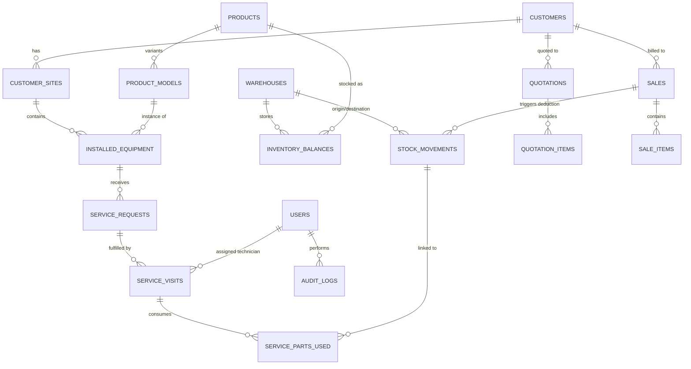

# Refrigeration POS, Inventory & Service Management — Implementation Plan

> **Base Software:** Free GST Billing Software (Offline-first React 19 + Express 5)  
> **Target System:** Integrated Refrigeration Business Management System (Admin Masters, Multi-Location Inventory, Cold-Room Technical Selection, Customer Sites & Equipment Register, Field Service & Van Stock, GST Compliance)  
> **Architecture Principle:** 100% Local, Offline-First, Zero-Cloud, Strict Localhost CORS, Embedded SQLite.

---

## 1. Executive Summary & Goals

This plan outlines the staged transformation of the existing local GST billing application into a unified refrigeration business management platform. It preserves all current invoicing, tax calculations, and PDF generation capabilities while adding:

1. **Centralized Admin Masters:** Product families, model specifications (refrigerant, capacity, electrical specs), multi-tier pricing, and charges.
2. **Multi-Location Inventory Engine:** Main warehouse, branch warehouses, and technician van stock governed by an immutable double-entry stock movement ledger.
3. **Cold-Room Technical Selection Engine:** Sizing and model recommendations derived from Emerson Ready Reckoner and Daikin Cold Room catalogues.
4. **Customer Multi-Site & Equipment Register:** Tracking equipment across customer facilities with serial numbers, commissioning records, warranties, and AMCs.
5. **Field Service & Engineer Operations:** Ticket dispatch, engineer scheduling, van stock parts consumption, and standardized Service Completion Reports.
6. **Robust Local Persistence:** Migration from individual flat `.json` files to an embedded SQLite database (`data/refrigeration.db`) with full transactional integrity, while preserving JSON export/import for user backups.

---

## 2. Core Architecture & Design Decisions

### 2.1 Persistence Layer: Embedded SQLite (`better-sqlite3`)
* **Database File:** `data/refrigeration.db`
* **Concurrency & Integrity:**
  * Enabled Write-Ahead Logging (`PRAGMA journal_mode = WAL;`) for fast concurrent reads and atomic writes.
  * Enforced Foreign Key Constraints (`PRAGMA foreign_keys = ON;`).
  * Atomic transactions with `BEGIN IMMEDIATE` for stock deductions and service parts allocations to eliminate race conditions.
* **Backward Compatibility & Backup:**
  * Existing `data/*.json` files are automatically migrated upon first run.
  * Granular JSON and Excel (`.xlsx`) export/import will remain the user-facing portability and disaster-recovery format.

### 2.2 Shared Domain Model
The same product, customer, equipment, and stock tables are reused across all modules:
* **POS & Invoicing** reads products, prices, and taxes from the master catalog and deducts stock from the selected warehouse.
* **Service Visits** consume parts from the assigned technician’s van stock location and link directly to the installed equipment unit.
* **Quotation Conversion** promotes an approved technical quotation directly into an active sales invoice or delivery challan without manual data re-entry.

---

## 3. Database Schema Blueprint (SQLite DDL)



### Table Structure Overview
1. **Identity & Masters:** `users`, `roles`, `permissions`, `user_roles`, `business_settings`, `areas`, `warehouses`
2. **Catalog & Pricing:** `product_categories`, `brands`, `products`, `product_models`, `model_specifications`, `tax_rates`, `product_prices`, `charge_items`
3. **Customers & Sites:** `customers`, `customer_contacts`, `customer_sites`
4. **Equipment & Service:** `installed_equipment`, `warranties`, `amc_contracts`, `service_requests`, `service_visits`, `service_parts_used`, `service_charges`
5. **Inventory & Movements:** `inventory_balances`, `stock_movements`, `purchase_bills`, `purchase_bill_items`, `stock_transfers`
6. **Quotations & Sales:** `quotations`, `quotation_items`, `sales`, `sale_items`, `payments`, `credit_notes`
7. **System & Audit:** `audit_logs`, `attachments`

---

## 4. Phased Implementation Roadmap

```
┌────────────────────────────────────────────────────────────────────────┐
│ Phase 1: Audit, Design & Documentation                [COMPLETED]     │
├────────────────────────────────────────────────────────────────────────┤
│ Phase 2: SQLite Data Layer, Migration & Admin Masters                 │
├────────────────────────────────────────────────────────────────────────┤
│ Phase 3: Multi-Location Inventory & Stock Ledger Engine                │
├────────────────────────────────────────────────────────────────────────┤
│ Phase 4: Cold-Room Sizing Engine & Technical Quotations               │
├────────────────────────────────────────────────────────────────────────┤
│ Phase 5: Customer Multi-Site & Installed Equipment Register           │
├────────────────────────────────────────────────────────────────────────┤
│ Phase 6: Field Service Management, Engineer Visits & Van Stock        │
├────────────────────────────────────────────────────────────────────────┤
│ Phase 7: Analytics, Reports, Excel Import/Export & Hardening          │
└────────────────────────────────────────────────────────────────────────┘
```

---

### Phase 1: Repository Audit, Design & Base Verification `[STATUS: COMPLETED]`
* **Deliverables:**
  * Full audit of existing React 19 + Express 5 codebase.
  * Virus and malware verification with Microsoft Defender.
  * Architecture analysis document (`docs/modify.md`).
  * Implementation plan (`docs/IMPLEMENTATION_PLAN.md`).

---

### Phase 2: SQLite Persistence Layer, Data Migration & Admin Masters
* **Objective:** Establish the embedded relational database, migrate existing user JSON data seamlessly, and provide admin management for product families, models, and prices.
* **Key Tasks:**
  1. Add `better-sqlite3` dependency and initialize `server/db/index.js` with WAL mode and foreign key enforcement.
  2. Implement `server/db/schema.sql` defining foundational tables (`business_settings`, `users`, `warehouses`, `categories`, `brands`, `products`, `product_models`, `product_prices`, `tax_rates`, `customers`, `sales`).
  3. Create automated migration script `server/db/migrate-json-to-sqlite.js`:
     * Takes a pre-flight snapshot of `data/` to `data/backups/pre-sqlite-migration-<timestamp>/`.
     * Ingests `bills/*.json`, `clients/*.json`, `products/*.json`, `purchases/*.json`, `expenses/*.json`, and `profile.json`.
     * Validates row count, monetary balances, and tax figures.
  4. Create Admin UI Views under `src/components/admin/`:
     * **ProductMaster.jsx:** Manage categories, brands, HSN/SAC, units, and stock tracking flags.
     * **ModelMaster.jsx:** Structured technical attributes (refrigerant, capacity, temperature range, voltage/phase, catalogue reference).
     * **PriceMaster.jsx:** Separate purchase cost, selling price, minimum price, and extra charges (labour, installation, transport).
     * **WarehouseMaster.jsx:** Manage main/secondary warehouses and engineer van stock locations.
* **Acceptance Criteria:**
  * Existing invoices and bills load identically with zero data loss.
  * Admin can create and edit products and models via UI.
  * Price changes are recorded in `price_change_history` with audit timestamps.

---

### Phase 3: Shared Multi-Location Inventory & Stock Ledger Engine
* **Objective:** Expand inventory from a single flat number to a multi-location, double-entry stock movement ledger.
* **Key Tasks:**
  1. Implement `stock_movements` and `inventory_balances` tables in SQLite.
  2. Create inventory service (`server/services/inventoryService.js`) supporting:
     * `OPENING_STOCK`: Initial stock entry.
     * `PURCHASE_RECEIPT`: Increased on vendor purchase bill.
     * `SALE_DEDUCTION`: Decreased on confirmed tax invoice or POS sale.
     * `CREDIT_NOTE_RETURN`: Restocked on approved credit note.
     * `VAN_TRANSFER`: Warehouse $\to$ Van or Van $\to$ Warehouse transfer.
     * `SERVICE_CONSUMPTION`: Decreased when an engineer confirms part usage on site.
     * `ADJUSTMENT_WRITE_OFF`: Stock reconciliation with required reason.
  3. Ensure atomic transactions:
     * Stock deductions verify that `available_quantity >= requested_quantity` before writing.
     * Negative stock is blocked unless an explicit authorized override is set.
  4. Connect POS / Invoice Generator to select source warehouse and deduct stock in a single transaction.
  5. Build `src/components/inventory/`:
     * **MultiLocationStock.jsx:** Stock breakdown across warehouses and engineer vans.
     * **StockLedgerView.jsx:** Filterable audit trail of every stock movement.
     * **StockTransferModal.jsx:** Inter-location transfers between warehouse and vans.
* **Acceptance Criteria:**
  * Confirmed sale of 2 units from Main Warehouse reduces only Main Warehouse stock by 2.
  * Transfer of 3 units to Van #1 reduces Warehouse by 3 and increases Van #1 by 3.
  * Draft quotations do not deduct stock.
  * Cancellation of a bill restores stock via a reversing movement entry.

---

### Phase 4: Cold-Room Sizing Engine & Technical Quotation Workflow
* **Objective:** Provide automated decision support for refrigeration sizing based on Emerson Ready Reckoner and Daikin catalogues, generating formal quotations.
* **Key Tasks:**
  1. Seed technical tables (`catalogue_sources`, `model_specifications`, `model_compatibility_rules`):
     * Emerson Ready Reckoner tables (Chiller: $+2^\circ\text{C}$ to $+8^\circ\text{C}$, Freezer: $-18^\circ\text{C}$ to $-25^\circ\text{C}$, Blast: $-35^\circ\text{C}$).
     * Daikin Cold Room condensing unit and evaporator pairing tables.
  2. Implement calculation engine (`server/services/coldRoomEngine.js`):
     * Input: Room dimensions ($L \times W \times H$ in meters/feet), product type, daily loading, ambient temperature, target room temperature.
     * Output: Calculated volume, estimated heat load (BTU/hr or Watts), recommended condensing unit and indoor unit models, cited catalogue document name and page number.
     * Safeguard: Flag "Technical review required" if inputs fall outside validated table boundaries.
  3. Build `src/components/quotation/TechnicalQuotationWizard.jsx`:
     * Step 1: Customer & Site selection.
     * Step 2: Cold-room parameters & ambient specifications.
     * Step 3: Recommended models preview + accessories list (piping, paneling, expansion valve, digital controller).
     * Step 4: Admin pricing & charge breakdown (equipment cost, labour, installation, transport, GST).
     * Step 5: Draft quotation preview with PDF generation.
  4. Implement Quotation $\to$ Invoice Conversion:
     * One-click conversion to Tax Invoice without re-entering line items.
* **Acceptance Criteria:**
  * Sizing recommendations display documented source and page references.
  * Quotations do not alter physical stock.
  * Converted quotation correctly creates an invoice and triggers inventory deduction.

---

### Phase 5: Customer Sites & Installed Equipment Register
* **Objective:** Enable multi-site customer profiles and complete equipment lifecycle tracking.
* **Key Tasks:**
  1. Expand Customer records to support multiple sites (`customer_sites`):
     * Multiple addresses per customer (Head Office, Cold Storage Plant 1, Warehouse Site 2).
     * Local site contact person and mobile number.
  2. Create `installed_equipment` table:
     * Unique equipment ID, serial number, product model reference, customer ID, site ID.
     * Commissioning date, commissioning engineer, warranty start/end dates, AMC contract reference.
  3. Build UI views in `src/components/equipment/`:
     * **CustomerProfileView.jsx:** Consolidated view of customer sites and equipment counts.
     * **InstalledEquipmentRegister.jsx:** Searchable by serial number, model, customer, or site.
     * **EquipmentTimeline.jsx:** Complete chronological log of an equipment unit (Quote $\to$ Invoice $\to$ Installation $\to$ Service Visits $\to$ Parts Replaced $\to$ AMC status).
  4. Automatic Equipment Registration:
     * Completed invoice line items for equipment trigger a "Register Installation" prompt to capture serial numbers and site location.
* **Acceptance Criteria:**
  * One customer can hold 5+ distinct physical sites.
  * Searching for a customer displays all linked sites and equipment.
  * Selecting an equipment unit shows only its specific service and maintenance history.

---

### Phase 6: Field Service Management, Engineer Visits & Van Stock
* **Objective:** Dispatch service requests, track technician visits, deduct parts from van stock, and output signed completion PDFs.
* **Key Tasks:**
  1. Implement Service Ticket system (`service_requests`):
     * Ticket number, customer, site, equipment ID, complaint description, priority, warranty status check.
  2. Engineer Assignment & Scheduling:
     * Engineer profiles linked to user accounts and mobile contact.
     * Assigned territories / areas and assigned van stock location.
  3. Build `src/components/service/`:
     * **ServiceRequestsView.jsx:** Ticket queue with status indicators (`Open` $\to$ `Assigned` $\to$ `In Progress` $\to$ `On Hold / Waiting for Parts` $\to$ `Completed` $\to$ `Closed`).
     * **EngineerDashboard.jsx:** Technician view of assigned jobs.
     * **ServiceVisitForm.jsx:** Capture arrival/departure time, root cause diagnosis, corrective work performed, and refrigerant/parts used.
  4. Van Stock Consumption Logic:
     * Selected parts are verified against the engineer's assigned van stock.
     * Upon visit sign-off, atomic transaction writes `service_parts_used` and deducts stock from `stock_movements`.
  5. Service Completion Report PDF:
     * Printable/downloadable document matching industry standard format: customer/site details, equipment serial, fault diagnosis, parts replaced, technician notes, customer signature capture.
  6. Chargeable Service Invoicing:
     * If out of warranty/AMC, generate service invoice lines for labour, travel, and parts.
* **Acceptance Criteria:**
  * Confirmed service parts usage deducts from the technician's van stock exactly once.
  * In-warranty equipment displays warranty badge and prevents accidental charge generation without manager override.
  * Service Completion PDF prints correctly with all fault and parts details.

---

### Phase 7: Analytics, Reports, Excel Import/Export & Hardening
* **Objective:** Comprehensive business intelligence, mass data import/export, and security hardening.
* **Key Tasks:**
  1. Reporting Views (`src/components/reports/`):
     * **Sales & Quotation Register:** Conversion rates and status breakdown.
     * **Multi-Location Inventory Valuation:** Stock value by warehouse/van (FIFO / Average Cost).
     * **Engineer Performance & Workload:** Completed visits, response time, and van parts consumed.
     * **Warranty & AMC Expiry Alerts:** Upcoming renewals within 30/60 days.
  2. Excel / CSV Imports & Exports:
     * Export master catalogs, customer sites, stock ledgers, and service histories with formula injection protection.
     * Bulk product and opening stock import with validation and preview before commit.
  3. Full System Hardening:
     * Audit log recording all sensitive price changes, role assignments, and stock write-offs.
     * Complete regression test execution (`npm run test:unit`, `npm test`, plus new service/stock regression test suite).
     * Verification of offline PWA operation and local automated backups.
* **Acceptance Criteria:**
  * All unit and smoke tests pass green.
  * Import validator rejects malformed rows without committing partial records.
  * System operates seamlessly offline without internet access.

---

## 5. Verification & Regression Testing Strategy

Every phase requires running the existing test suite plus new scenario-based tests:

| Test Suite | Purpose | Execution Command |
| :--- | :--- | :--- |
| **Existing Tax & Invoicing Tests** | Verifies GST splits, decimal rounding, and reverse charge rules | `node scripts/tax-test.mjs` |
| **Discount & CSV Tests** | Verifies line/document discounts and CSV formatting | `node scripts/discount-modes-test.mjs && node scripts/csv-test.mjs` |
| **Playwright Smoke Tests** | End-to-end browser tests for invoice generation, preview, and print | `npm test` |
| **Inventory ACID Regression** | Verifies multi-location stock movements, concurrency, and reversal | `node scripts/inventory-test.mjs` *(New)* |
| **Service & Van Stock Tests** | Verifies parts deduction from van stock and warranty charge logic | `node scripts/service-test.mjs` *(New)* |

---

## 6. Next Steps

With this implementation plan established:
1. **Approval:** Review and approve the phased plan.
2. **Execution:** Begin **Phase 2 (SQLite Data Layer & Admin Masters)** by installing `better-sqlite3`, initializing the schema, and migrating existing JSON data.
